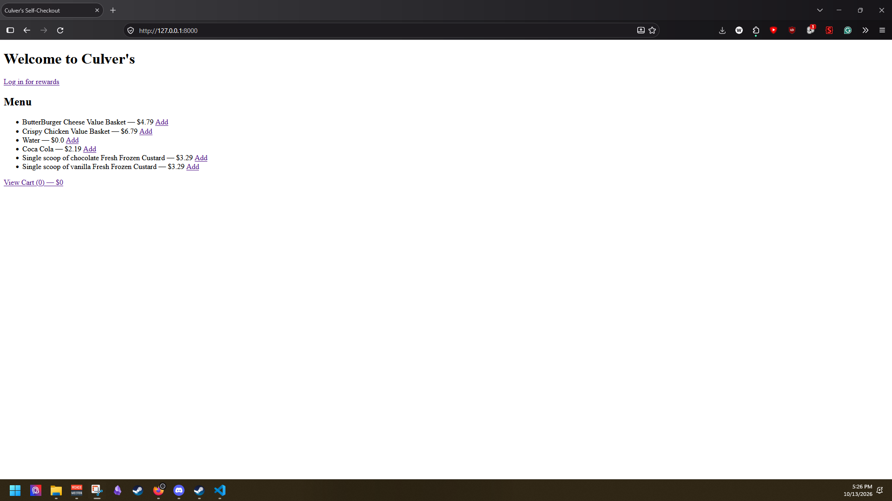
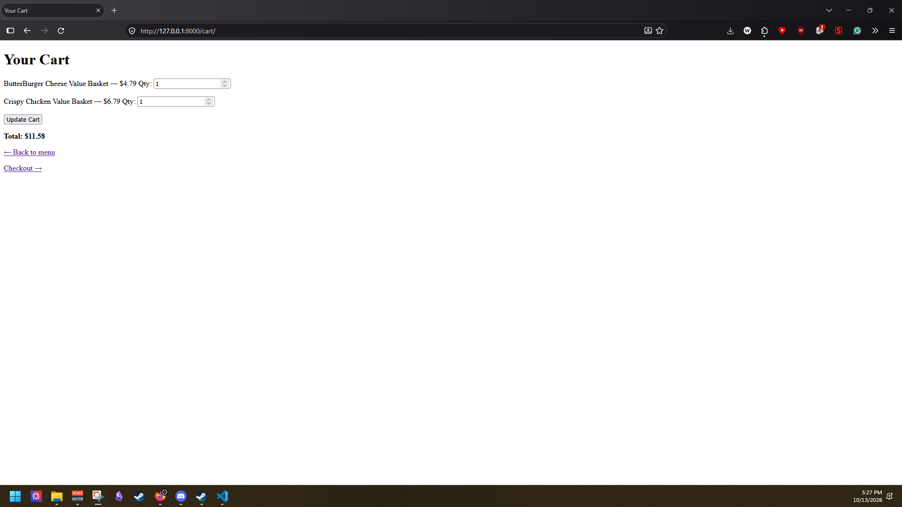
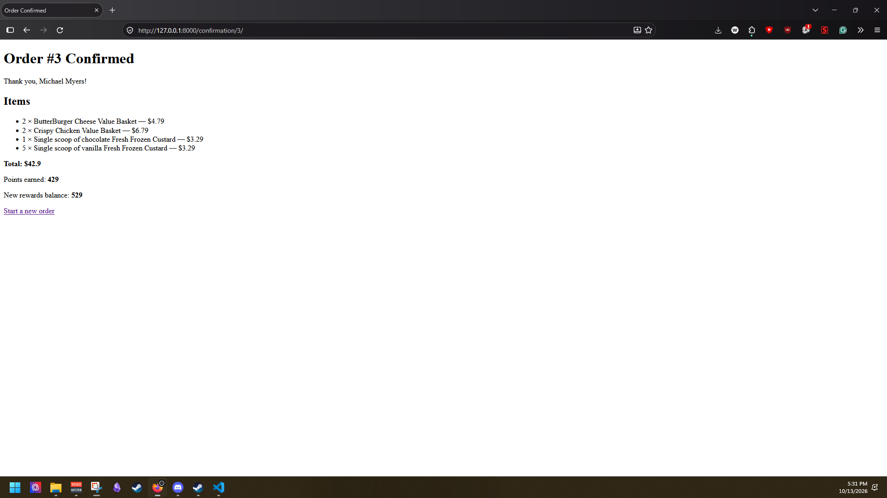
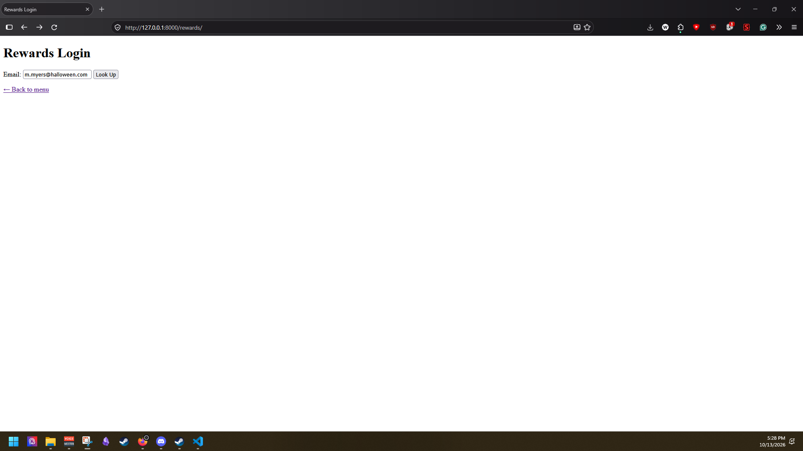
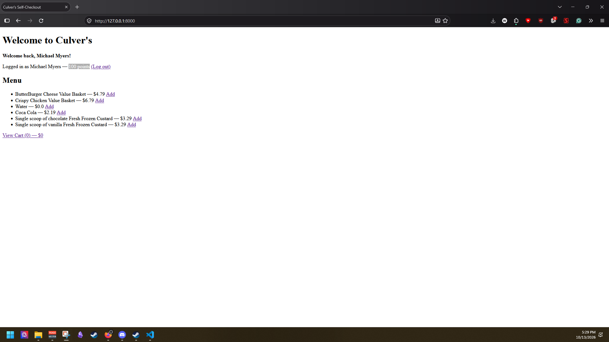

# SDEV_220_Final_Project_Pouncing_Pythons
A Django web application for self-ordering and rewards at Culver's.

## Team
- **Kaelin** — Project Manager, Database
- **Wesley** — Designer/Developer
- **Adam** — UI/UX

## Tech Stack
- Python 3.14
- Django 6.1
- SQLite (via Kaelin's db.py)

## Setup Instructions
1. Clone the repo
2. `python -m venv venv`
3. `venv\Scripts\activate` (Windows) or `source venv/bin/activate` (Mac/Linux)
4. `pip install django`
5. `python -c "import db; db.init_db()"`
6. `python manage.py migrate`
7. `python manage.py runserver`
8. Visit http://127.0.0.1:8000/

## Features
- Browse menu
- Add/remove items from cart
- Rewards login by email
- Earn 10 points per $1 spent
- Order confirmation with points summary
- Rewards logout

## Test Accounts
- m.myers@halloween.com (100 points)
- p.wise@halloween.com (100 points)

- ## Screenshots

## Project Structure
Pouncing Pythons/
- db.py                    # Database layer (K)
- manage.py                # Django entry point
- README.md                # This file
- culvers_project/         # Django settings package
  - settings.py
  - urls.py
  - wsgi.py
- checkout/                # Main app
  - views.py               # Menu, cart, rewards, checkout views
  - urls.py                # URL routes
  - templates/
    - checkout/
      - menu.html
      - cart.html
      - rewards.html
      - confirmation.html
                menu.html
                cart.html
                rewards.html
                confirmation.html
